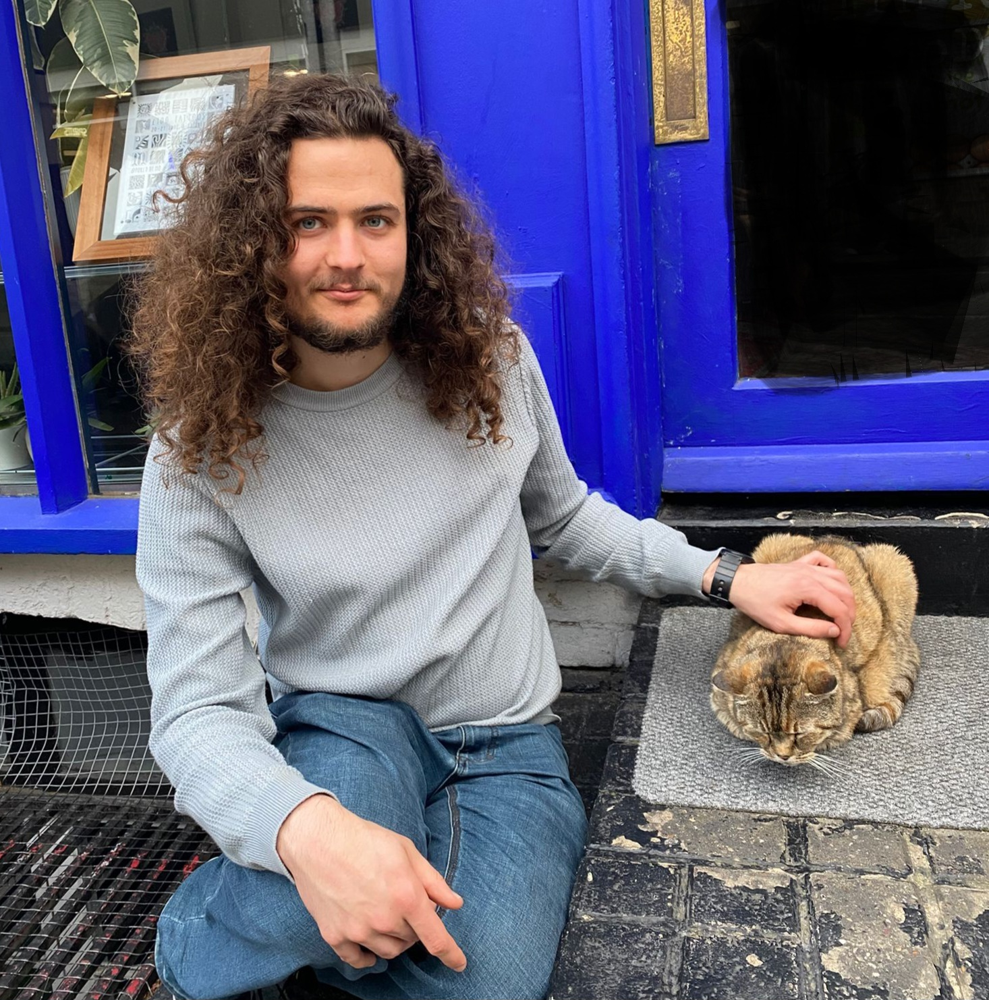

 

## About

I am a third year Mathematics DPhil student at the University of Oxford, supervised by [Lukas Brantner](https://people.maths.ox.ac.uk/brantner/). 

I am mostly interested in homotopy theory and derived algebraic geometry, especially in mixed characteristic or arithmetic situations.

## Research papers

 <strong> The period map from commutative to noncommutative deformations </strong> (Dec. '25). [  <a href="https://arxiv.org/abs/2512.24347"> arXiv.</a> (https://arxiv.org/abs/2512.24347) \emph{Submitted}.

We study the period map from infinitesimal deformations of a qcqs derived scheme $X$ over a field $k$ to those of the associated $k$-linear $\infty$-category $\mathrm{QC}(X)$. We identify the corresponding map on tangent fibres with the dual HKR map $\mathrm{R}\Gamma(X,\mathbf T_{X/k})[1] \longrightarrow \mathrm{HH}_{\bullet}(X/k)[2]$ and study its injectivity on homotopy groups. As applications, we show liftability of qcqs schemes along square-zero extensions to be a derived invariant, at least when $\mathrm{char}(k) \ne 2$, and exhibit cases where the entire classical deformation functor of $X$ is a derived invariant; this partially answers a question of Lieblich.

## Talks

_Deformations of schemes and derived categories_: Oxford Algebraic and Symplectic Geometry seminar (Feb. '26)

_Deformations of schemes and infinity categories_: Cambridge Junior Geometry Seminar (Feb. '26)

 